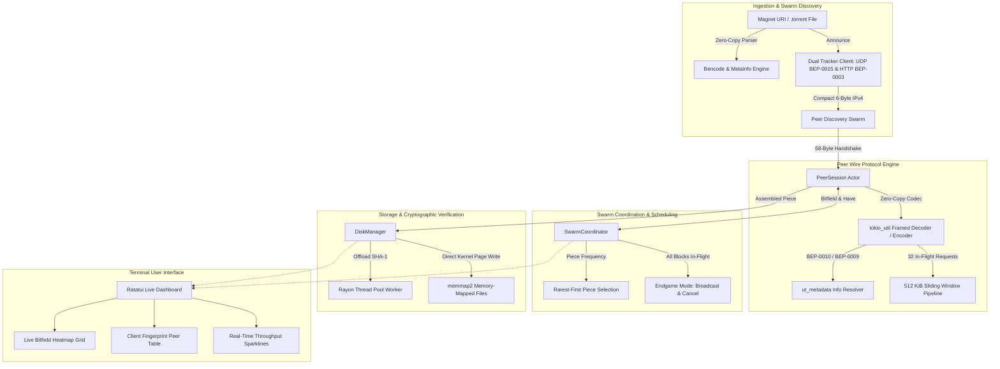

# bolt ⚡

[](https://www.rust-lang.org)
[]()
[]()

A high-performance, asynchronous BitTorrent engine built from scratch in Rust with zero-copy Bencode parsing, dual UDP/HTTP tracker clients, pipelined peer wire streaming, rarest-first swarm coordination with endgame tail-latency mitigation, memory-mapped disk I/O, and an interactive `ratatui` terminal dashboard.

---

## Architecture Overview



---

## Supported BitTorrent Enhancement Proposals (BEPs)

| BEP | Specification | Implementation Highlights |
| :--- | :--- | :--- |
| **BEP-0003** | The BitTorrent Protocol | Zero-copy message framing, choke/unchoke flow control, 68-byte handshakes, SHA-1 canonical piece validation. |
| **BEP-0009** | `ut_metadata` Extension | Retrieves the torrent `info` dictionary directly from peers when starting from Magnet URIs. Zero-copy delimiter split between bencoded header and raw binary chunk. |
| **BEP-0010** | Extension Protocol | Extended handshake negotiation (`ID 20`) with dynamic extension mapping (`m` dictionary), `metadata_size`, and version identification. |
| **BEP-0012** | Multitracker Extension | Tiered backup announce list parsing (`announce-list`) with fallback tier rotation. |
| **BEP-0015** | UDP Tracker Protocol | Binary 16-byte connect datagrams (`0x41727101980` magic ID), 98-byte announce frames in big-endian network byte order, replay-protection transaction IDs, error packet decoding. |
| **BEP-0023** | Compact Peer Lists | Binary 6-byte IPv4+Port chunk decoding (4 bytes IP + 2 bytes big-endian port), reducing tracker ingress bandwidth by ~88%. |

---

## Core Components

### 1. Custom Zero-Copy Bencode Parser (`src/bencode.rs`)
- Parses arbitrary Bencode payloads over borrowed byte slices (`&'a [u8]`) without heap-allocating intermediate strings.
- Retains exact byte offsets and raw slices (`raw_value: &'a [u8]`) for inner dictionaries, allowing instant cryptographic SHA-1 calculation of the canonical `info` dictionary without re-serializing.
- Offers both lenient and strict lexicographical key-ordering verification modes.

### 2. Standalone Cryptographic SHA-1 Engine (`src/sha1.rs`)
- Zero-dependency implementation adhering to RFC 3174 / FIPS PUB 180-4.
- Transforms 512-bit message blocks across 80 expansion rounds using non-linear conditional, parity, and majority operations with big-endian length padding.
- Verified against standard NIST test vectors.

### 3. Binary UDP & HTTP Tracker Clients (`src/tracker/`)
- **UDP (BEP-0015)**: Two-phase asynchronous transaction engine performing connect negotiation and announce querying with socket timeout enforcement and transaction ID spoofing validation.
- **HTTP (BEP-0003 / BEP-0023)**: RFC 3986-compliant arbitrary binary percent-encoder (`%XX`) preventing UTF-8 mangling of arbitrary 20-byte `info_hash` and `peer_id` digests, with support for compact 6-byte IPv4 strings and legacy dictionary lists.

### 4. Pipelined Peer Wire Protocol (`src/peer/`)
- Zero-copy framing implemented via `tokio_util::codec::Decoder` and `Encoder`, turning incoming TCP frame buffers directly into zero-copy `bytes::Bytes` blocks via `BytesMut::split_to` and `freeze()`.
- **PeerSession Actor**: Maintains a continuous sliding window of **32 in-flight 16 KiB block requests** (512 KiB pipeline) whenever unchoked, preventing network bandwidth-delay product (BDP) starvation.
- In-memory piece accumulator tracking received chunk masks and validating completed pieces against expected SHA-1 digests.
- Decodes Azureus-style client ID fingerprints (`-qB4390-` -> `qBittorrent 4.3.9`, `-TR3000-` -> `Transmission 3.0.0`, `-LT1214-` -> `libtorrent 1.2.1.4`, `-UT3530-` -> `uTorrent 3.5.3`).

### 5. Swarm Coordination & Scheduling (`src/coordinator.rs`)
- Tracks peer availability bitfields and computes dynamic piece rarity histograms.
- **Rarest-First Selection**: Schedules rarest pieces first to maximize swarm entropy, using rotating tie-breakers to prevent swarm request clustering.
- **Endgame Mode**: Automatically activates when all remaining unreceived blocks are already in flight. Duplicates requests across all available unchoked peers and immediately dispatches `Cancel` frames to peer sessions when duplicate blocks arrive.

### 6. Storage & Rayon Verification (`src/disk.rs`)
- **Rayon Thread Pool**: Offloads CPU-intensive SHA-1 digest computations over 256 KiB - 4 MiB piece buffers to a worker thread pool, preventing Tokio reactor latency spikes.
- **Memory-Mapped Storage via `memmap2`**: Pre-allocates and memory-maps files into process virtual memory, writing verified piece slices directly into kernel page cache across both single-file and multi-file directory trees.

### 7. Ratatui Terminal User Interface (`src/ui/`)
- **Live Bitfield Heatmap**: Adaptive 2D grid rendering piece statuses with custom color coding:
  - Green `■`: Downloaded and verified on disk
  - Yellow `▲`: Actively in-flight
  - Cyan `░`: Rare in swarm (availability $\le 2$)
  - Dark Gray `·`: Missing / Unrequested
- **Connected Peer Table**: Live telemetry showing peer IP:Port, parsed client software name, download/upload speeds, choke/interest flags, and progress percentages.
- **Real-Time Throughput Sparklines**: 60-second rolling history graphs for upload and download bandwidth.
- **Top Metrics Panel**: Torrent name, info_hash, operational badge (`[DOWNLOADING]`, `[ENDGAME MODE]`, `[RESOLVING MAGNET METADATA]`), and overall progress gauge.

---

## Code Example

```rust
use bolt::{
    coordinator::SwarmCoordinator,
    disk::DiskManager,
    extensions::ExtendedHandshake,
    magnet::MagnetLink,
    peer::{Handshake, PeerSession, BLOCK_SIZE_16KIB, PIPELINE_CAPACITY_32},
    torrent::Metainfo,
    tracker::{udp::UdpTrackerClient, AnnounceEvent, AnnounceRequest},
};
use rayon::ThreadPoolBuilder;
use std::path::Path;

#[tokio::main]
async fn main() -> Result<(), Box<dyn std::error::Error>> {
    /* parse magnet link */
    let magnet = MagnetLink::parse(
        "magnet:?xt=urn:btih:c12fe1c06bba254a9d1b00f12abb1f30c1d322ce&dn=ubuntu-22.04.iso"
    )?;
    println!("info_hash: {}", magnet.info_hash_hex());

    /* query udp tracker for peers */
    let udp_client = UdpTrackerClient::default();
    let announce_req = AnnounceRequest {
        info_hash: magnet.info_hash,
        peer_id: [0x55; 20],
        port: 6881,
        uploaded: 0,
        downloaded: 0,
        left: 0,
        event: AnnounceEvent::Started,
        num_want: Some(50),
    };
    
    /* initialize disk manager with rayon worker pool */
    let pool = ThreadPoolBuilder::new().num_threads(4).build()?;
    let disk = DiskManager::new_single_file(
        Path::new("ubuntu-22.04.iso"),
        1024 * 1024 * 1024, /* 1 GiB */
        262144,              /* 256 KiB piece length */
        vec![[0u8; 20]; 4096],
        pool,
    )?;

    Ok(())
}
```

---

## Project Structure

```text
src/
├── bencode.rs            /* zero-copy BEP-0003 Bencode parser over &[u8] */
├── coordinator.rs        /* swarm coordinator, rarest-first scheduling, endgame mode */
├── disk.rs               /* memmap2 memory-mapped I/O & rayon SHA-1 piece verification */
├── extensions/
│   ├── mod.rs            /* BEP-0010 extension protocol & extended handshake */
│   └── metadata.rs       /* BEP-0009 ut_metadata info dictionary resolver */
├── lib.rs                /* public module exports and top-level re-exports */
├── magnet.rs             /* magnet URI parser (hex & base32 decoding) */
├── peer/
│   ├── client_info.rs    /* peer ID client fingerprint decoder (Azureus-style) */
│   ├── codec.rs          /* zero-copy peer wire message framing (Encoder/Decoder) */
│   ├── mod.rs            /* 68-byte handshake negotiation & wire error types */
│   └── session.rs        /* PeerSession actor, 32-block pipeline, piece reassembly */
├── sha1.rs               /* standalone RFC 3174 cryptographic SHA-1 implementation */
├── torrent.rs            /* .torrent metainfo parser & file tree representation */
├── tracker/
│   ├── http.rs           /* BEP-0003 / BEP-0023 HTTP tracker client */
│   ├── mod.rs            /* common tracker definitions & compact peer parser */
│   └── udp.rs            /* BEP-0015 binary UDP tracker client */
└── ui/
    ├── app.rs            /* TUI state model, throughput sparkline buffers, peer items */
    └── mod.rs            /* ratatui dashboard layout, bitfield heatmap, peer table */
```

---

## Running Tests

Execute the comprehensive test suite verifying zero-copy parsing, NIST SHA-1 vectors, wire encoding, pipelining, endgame mode, disk mapping, and deterministic TUI rendering:

```bash
cargo test
```

Run strict Clippy static analysis:

```bash
cargo clippy -- -D warnings
```

---

## Style & Convention Compliance

This codebase strictly adheres to specific low-level systems programming conventions:
- **Comment Style**: Exclusively block comments `/* ... */` across all code and test files (no `//` or `///`).
- **Comment Casing**: Every natural English comment starts with a lowercase letter.
- **Identifier Casing**: Preserves uppercase casing for protocol names, architectural terms, flags, and symbol names (`SHA-1`, `BEP-0003`, `BEP-0009`, `BEP-0010`, `BEP-0012`, `BEP-0015`, `BEP-0023`, `RAREST_FIRST`, `ENDGAME`, `MEMMAP2`, `RAYON`, `TUI`, `TCP`, `UDP`, `IPv4`).
- **Educational Value**: Clear explanatory commentary detailing memory layout, big-endian network byte orders, sliding window mechanics, kernel page caching, and lockless zero-copy buffer slicing.

---

## License

Dual-licensed under either of:
- Apache License, Version 2.0 ([LICENSE-APACHE](LICENSE-APACHE))
- MIT License ([LICENSE-MIT](LICENSE-MIT))

at your option.
